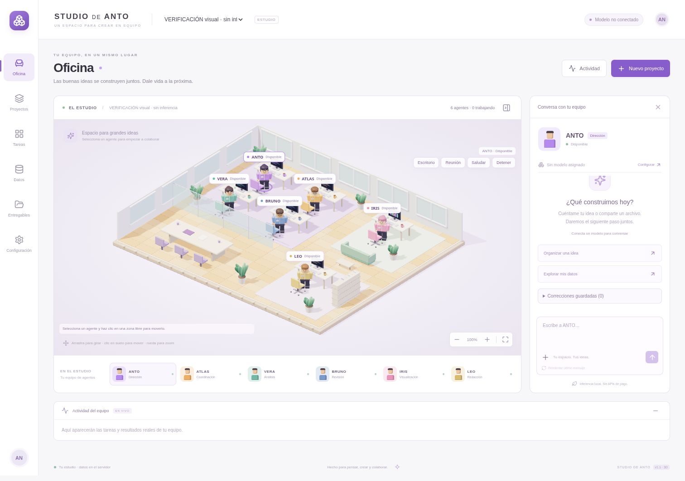

# STUDIO DE ANTO · 1.1 · mundo 3D

Una oficina 3D interactiva con seis personajes articulados, APIs locales de IA y herramientas de análisis. Sin APIs de pago, Docker, Redis ni VS Code obligatorio.



**¿Quieres ejecutarlo en la nube de GitHub?** Abre [la rama de STUDIO](https://github.com/juancito222444-beep/virello-ghpages/tree/codex/studio-de-anto-modelo-real) y sigue [la guía de Codespaces](docs/CODESPACES.md). El devcontainer de esta entrega prepara también el modelo compacto y prueba su inferencia. GitHub Pages no ejecuta el backend Python ni el modelo.

## Primera instalación

Necesitas **Python 3.12** y **Node.js 22 o 24** instalados. La primera instalación requiere internet; la interfaz compilada, los cálculos y las exportaciones funcionan después sin conexión. El modelo se prepara con el comando explícito de la siguiente sección; el arranque habitual no descarga modelos.

**Windows:** descomprime el proyecto en una carpeta propia. Haz doble clic en `Instalar-Windows.cmd`. Después abre `Iniciar-Windows.cmd`.

**Linux/macOS:** abre una terminal en la carpeta del proyecto y ejecuta:

```bash
bash scripts/install.sh
bash scripts/start.sh
```

Con la aplicación ejecutándose **en tu computadora**, abre `http://127.0.0.1:8765` en tu navegador. Mantén abierta la ventana del servidor. Para detener: Ctrl+C. Los scripts Windows se entregan, pero solo se ejecutaron los de Linux en este entorno.

## Conectar una API y un modelo real

La opción principal es **Ollama**, gratuita y local. Una API no incluye por sí misma un modelo ni mejora sus pesos automáticamente. La suscripción o acceso gratuito de ChatGPT no equivale a una API GPT gratuita. No se han añadido dependencias de servicios de pago.

Con la aplicación ya iniciada, abre **otra terminal en la carpeta del proyecto** y ejecuta:

```bash
python scripts/setup-model.py --download --test
```

En Windows puedes usar `.venv\Scripts\python.exe`; en Linux/macOS, `.venv/bin/python`. El comando prepara **qwen2.5:3b**, inicia o reutiliza Ollama, comprueba el tamaño antes de descargar y configura los agentes que aún no tengan modelo. Los pesos rondan 1,9 GB; el límite permitido por el instalador es 2,2 GB. Si falta Ollama en Linux x86-64, obtiene la distribución oficial fijada, comprueba SHA-256 y conserva sus bibliotecas CPU. Esa distribución requiere otros 1,51 GB de descarga; necesita `zstd`, incluido en el contenedor de Codespaces. En Windows/macOS instala primero [Ollama oficial](https://ollama.com/download).

`--test` envía una petición real a la aplicación y guarda el diagnóstico en `local-data/readiness.json`. Si la red bloquea la descarga o la inferencia falla, el comando termina con error y no anuncia un modelo listo. Repetirlo reutiliza el modelo instalado. `--model nombre:etiqueta` permite elegir otro modelo dentro del límite; `--configure` reemplaza explícitamente las asignaciones existentes. No altera instrucciones ni conversaciones.

Después, en **Configuración → APIs y modelos**, puedes consultar el catálogo y usar **Guardar y probar inferencia** para cualquier agente. Selecciona ANTO en la oficina y conversa: la respuesta llega por streaming desde la API.

Para comprobar además planificación y ejecución, con el servidor activo:

```bash
.venv/bin/python scripts/verify-real-model.py --run
```

La prueba crea un proyecto sintético separado, compara planes de ingresos, unidades y filtro Norte, ejecuta ingresos y revisa cifras y entregables. Guarda evidencia en `local-data/model-acceptance.json`; requiere el modelo real y no usa un plan fijo como respaldo. El comentario narrativo sigue necesitando revisión humana.

**Alternativa: LM Studio o llama.cpp.** Activa su servidor local compatible con el formato OpenAI. Selecciona **API local compatible** y configura su URL base, por ejemplo `http://127.0.0.1:1234/v1` si coincide con tu servidor. Comprueba la API y elige un modelo que anuncie. Los planes requieren soporte de JSON Schema; los servidores que lo rechazan muestran un error y no ejecutan planes sin validar. “Compatible” describe el protocolo, no acceso a GPT de OpenAI.

Solo una inferencia pesada a la vez. Ollama recibe `keep_alive=0`; la gestión de memoria de LM Studio/llama.cpp depende de su servidor. Los planes usan JSON Schema, temperatura cero y un máximo de tres intentos para reparar errores de validación. Se rechazan columnas inexistentes, tareas vacías o dependencias que omitan la revisión matemática. El contexto es limitado, no memoria infinita. Puedes añadir resultados con el selector de ejecución.

**El localhost de la nube pertenece a la nube.** No conecta a tu PC. En este entorno están instalados Ollama 0.40.9 y Qwen 2.5 de 3B: los seis agentes tienen el modelo asignado y la inferencia real respondió «Conexión correcta» en 9,9 segundos. Los pesos ocupan 1.929.912.432 bytes según el manifiesto; Ollama verificó sus SHA-256. El entorno dispone de cuatro CPU efectivas y unos 33 GiB de RAM, sin GPU NVIDIA accesible; eso no describe tu RTX 3060. Una respuesta de conexión no certifica la calidad de los análisis.

## Correcciones que el equipo recuerda

En cada respuesta guardada puedes pulsar **Útil** o escribir y guardar una corrección. Las correcciones explícitas se conservan por proyecto y agente, se pueden consultar y borrar, y como máximo tres se aportan a futuras conversaciones de ese agente. No cambian sus herramientas ni permisos.

Esto mejora el contexto de trabajo con tus preferencias; **no reentrena el modelo ni hace que una API se mejore por sí sola**. No se modifica código automáticamente ni se reutilizan estas valoraciones como una supuesta prueba de calidad objetiva.

## Probar sin modelo: modo herramientas

1. En **Datos**, sube `examples/ventas_sinteticas.csv`, identificado como sintético.
2. Agrupa por `producto`. Activa **Calcular ingresos = cantidad × precio** y selecciona ambas columnas. Unidad: la que corresponda al archivo (el ejemplo no declara moneda).
3. Prepara el plan. En **Tareas**, revisa los argumentos y pulsa **Aprobar y ejecutar**.
4. El resultado esperado es A=50, B=50, total=100. Con el filtro `region` igual a `Norte`, el total es 70.
5. Para unidades, desactiva la fórmula y selecciona la métrica `cantidad`: A=5, B=1.
6. En **Entregables**, descarga CSV, XLSX, PNG, Markdown, HTML, evidencia JSON, manifiesto y ZIP. Cada ejecución usa una carpeta única.

La elección de columnas en herramientas es explícita y no se anuncia como interpretación de IA. Para un objetivo en lenguaje libre, usa **Tareas → Proponer plan con API**. ATLAS recibe el esquema y una muestra; puede solicitar aclaración. Revisa siempre la definición de las métricas antes de aprobar.

## La oficina 3D

Personajes originales de bloques, con cabeza, manos, brazos y piernas articulados. Geometría Three.js, materiales, iluminación y sombras; mobiliario, monitores, vidrio, vegetación y parquet. Es un diorama 3D estilizado, sin recursos oficiales de LEGO.

- **Seleccionar:** pulsa el personaje, su nombre flotante o su ficha en el equipo.
- **Mover:** clic en suelo libre. Se calcula una ruta evitando muebles, divisiones y reservas de otros personajes.
- **Escritorio / Reunión:** destinos visuales mediante botones accesibles.
- **Detener:** cancela la espera o el desplazamiento visual al alcanzar una celda segura, sin cancelar tareas de IA.
- **Saludar:** animación del personaje seleccionado. Es un gesto visual, no una respuesta del modelo.
- **Cámara:** arrastra para girar, botón derecho para desplazar y rueda/botones para zoom. Restablecer devuelve la vista inicial. En táctil: un dedo gira; dos dedos desplazan/acercan.
- **Movimiento reducido:** en Configuración. Conserva acciones y estados sin marcha animada.

Cuando un agente está trabajando, las acciones manuales no interfieren con su tarea. Las animaciones representan eventos del backend y no determinan la finalización. El color y el texto distinguen actividad, espera y fallo. Si WebGL no está disponible, se explica y la lista de equipo sigue permitiendo seleccionar conversaciones.

## Datos, persistencia y respaldo

SQLite contiene configuración, historial, planes, tareas, dependencias, eventos, revisiones y artefactos. Las migraciones idempotentes viven en `backend/store.py`; conservan datos existentes y añaden valoraciones y procedencia de mensajes. En un reinicio, las ejecuciones activas se marcan interrumpidas; no se repiten automáticamente tareas terminadas. Para corregir, describe el cambio en el objetivo y pulsa Solicitar corrección: se prepara una nueva ejecución que requiere aprobación.

Los originales, gráficos y base están en `local-data/` (o `ANTO_DATA_DIR`). Detén el servidor y copia **toda esa carpeta** para respaldar. Restaura la carpeta completa antes de arrancar. No compartas esa carpeta si contiene datos privados. El ZIP del código no contiene conversaciones ni tus archivos.

CSV permite separador y codificación; XLSX enumera hojas. No se eliminan duplicados ni se imputan faltantes silenciosamente. Límite: 20 MB por subida, 200 000 filas y 150 MB de contenido XLSX expandido. Se rechazan encabezados repetidos. Valores mixtos incompatibles con una operación numérica provocan error en vez de conversión silenciosa.

El arranque local escucha en 127.0.0.1 y restringe Host/Origin. El script Codespaces admite el hostname exacto del puerto reenviado y requiere mantenerlo privado. No lo expongas a internet: no incluye autenticación multiusuario. Las operaciones permitidas no ejecutan código del modelo. Los documentos se tratan como datos, pero ningún modelo garantiza inmunidad semántica a instrucciones maliciosas: revisa el plan aprobado. El HTML se convierte con Markdown y se sanitiza con Bleach. El comentario libre del modelo se etiqueta como pendiente de revisión; la aprobación matemática solo certifica los cálculos deterministas.

## Desarrollo y pruebas

```bash
.venv/bin/python -m pytest -q
cd frontend
npm run build
```

Desarrollo con recarga: backend `.venv/bin/python -m uvicorn backend.app:app --host 127.0.0.1 --port 8765 --reload`; frontend `npm run dev` en otra terminal. Vite reenvía `/api` al backend.

Las pruebas sintéticas y del proveedor mock están separadas en `tests/test_acceptance.py`. No son evidencia de inferencia real. Las comprobaciones de navegador utilizan Chromium y Playwright; consulta `docs/VALIDACION.md`. Las de navegación y reservas no necesitan WebGL ni modelos.

## Qué falta

Consulta [el inventario completo](docs/QUE_FALTA.md), que separa implementación y comprobaciones reales.

El modelo real ya está conectado. La planificación y colaboración se someten a la aceptación sintética descrita en [VALIDACION](docs/VALIDACION.md). Queda crear y validar el Codespace desde tu cuenta, porque la integración no dispone de permisos suficientes; auditar el Python y video originales cuando se reciban; y ampliar revisión semántica, series temporales, reanudación selectiva y ComfyUI. La aplicación no incluye GPT de OpenAI ni reentrenamiento autónomo.

## Referencias

- `PROMPT_MEJORADO.md`: especificación mejorada con énfasis en mundo de bloques interactivo y aceptación verificable.
- `docs/ESPECIFICACION_ORIGINAL.txt`: adjunto original conservado íntegro.
- `PROGRESO.md`: avance y comandos.
- FastAPI: https://fastapi.tiangolo.com/
- Ollama API: https://docs.ollama.com/api/chat y https://docs.ollama.com/api/tags
- Three.js: https://threejs.org/docs/
- LM Studio API: https://lmstudio.ai/docs/developer/openai-compat

Gráficos procedurales originales; no se incluyen marcas ni activos oficiales de LEGO. Las dependencias conservan sus propias licencias.
